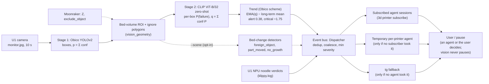

# Printer vision tuning: verifier, thresholds, bed-change detectors (2026-10-15)

Issue [#150](https://github.com/alex-mextner/3d-cli/issues/150). Follows
[printer-vision.md](printer-vision.md) (stage 1 alone) and
[printer-vision-geometry.md](printer-vision-geometry.md) (camera model). Command reference:
[docs/commands/printer-vision.md](../commands/printer-vision.md).

## Why a second stage

On 2026-10-14 the U1 printed `u1_walls_main_v3` in speckled grey filament: black/white mix with
green purge specks. Obico's detector boxed the walls as spaghetti, with raw frame scores of 0.83,
0.99 and 1.2. Real U1 spaghetti scores 2.2–3.2. Obico's `p` is the sum of box confidences
(0.41 + 0.28 + 0.19 + 0.12 ≈ 0.99), and the detector reacts to texture, so it cannot separate these
walls from loose filament. The alarm the user saw that day came from a temporary watchdog script
that alerted on raw `p ≥ 0.3` with no trend. The trend was 0.144 at that moment, below the 0.38
alert.

## Pipeline



`vision_spaghetti_vetoed` (info) is emitted when the raw trend would have warned but
`q < VETO_RATIO · p`. Agents can audit vetoes with it; it never pages anyone.

## Data

- **Public collection**: `~/.cache/3d-cli/vision/datasets` (outside the repo, licences per
  image), 6387 images from 15 sources. Each source sits wholly in one split: `tune` (4128) or
  `test` (2259). Positive = `spaghetti`; negative = `healthy`. `stringing` is not an alert and is
  reported separately. Every image was scored once with both stages (`tune/scores/public.jsonl`).
  These are single photos, so the numbers below are per image, not per print.
- **U1 live**: 870 frames of the speckled-wall print (`u1rec_walls`, recorded with
  `3d printer vision record`, with Z and object context), 4082 U1 timelapse frames of healthy
  prints, and 6 frames of real U1 spaghetti from 2026-10-14.

## Results: public test split (360 spaghetti, 982 healthy)

Per image: a frame counts as flagged when its score is at or above the threshold.

| threshold | raw p precision | raw p recall | raw p healthy FP | verified q precision | verified q recall | verified q healthy FP |
|---:|---:|---:|---:|---:|---:|---:|
| 0.1 | 0.856 | 0.894 | 54 (5.5 %) | 0.994 | 0.878 | 2 (0.2 %) |
| 0.2 | 0.928 | 0.892 | 25 (2.5 %) | 0.997 | 0.864 | 1 (0.1 %) |
| 0.3 | 0.954 | 0.872 | 15 (1.5 %) | 1.000 | 0.850 | 0 |
| **0.38** (alert) | 0.966 | 0.856 | 11 (1.1 %) | **1.000** | **0.842** | **0** |
| 0.5 | 0.984 | 0.831 | 5 | 1.000 | 0.806 | 0 |
| 0.78 | 0.993 | 0.756 | 2 | 1.000 | 0.733 | 0 |

The `printer_cam` view only (fixed printer cameras, 2162 images) at 0.38: p precision 0.959,
recall 0.895; q precision 1.000, recall 0.881.

At 0.38 the verifier removes all 11 healthy false positives and costs 5 of 360 spaghetti images
(1.4 points of recall).

Other test labels at 0.38 (flagged / total; these are not what the detector is for):

| label | p | q |
|---|---:|---:|
| stringing | 73/180 | 41/180 |
| detached | 19/162 | 11/162 |
| layer_shift | 4/297 | 0/297 |
| warping | 0/147 | 0/147 |
| cracking | 0/114 | 0/114 |

U1 look-alike tags among healthy test images: speckled 0/52, snapmaker_u1 0/27 and
multicolor_layers 0/29 for both p and q at 0.3.

Spaghetti recall at 0.38 per test source (p → q): zenodo_fff_qc 143/143 → 143/143,
hongyu_fdm 75/88 → 73/88, alexgrigoras 29/31 → 29/31, ft3d 38/55 → 36/55, javiai 23/43 → 22/43.
The javiai misses are hand-held web photos.

## Results: public tune split (1064 spaghetti, 2806 healthy)

| threshold | p recall | p healthy FP | q recall | q healthy FP |
|---:|---:|---:|---:|---:|
| 0.2 | 0.734 | 84 | 0.656 | 27 |
| 0.3 | 0.710 | 64 | 0.626 | 16 |
| 0.38 | 0.695 | 53 | 0.601 | 10 |
| 0.5 | 0.669 | 39 | 0.576 | 9 |

The tune split is harder: 778 of its 1064 spaghetti images come from masamsa (heterogeneous web
frames). There q drops recall from 487 to 388 spaghetti images at 0.38. On the other tune
sources the verifier keeps nearly every positive (hyungjungkim 155 → 154, lekangji 92 → 91).

## Results: Snapmaker U1

| set | frames | max p | max q | p ≥ 0.3 | q ≥ 0.3 | tracker alerts |
|---|---:|---:|---:|---:|---:|---:|
| speckled walls, live (ROI on) | 870 | 1.953 | 0.275 | 280 | 0 | **0** |
| healthy timelapses | 4082 | 0.137 | 0.077 | 0 | 0 | 0 |
| real spaghetti 2026-10-14 | 6 boxed | 3.21 | 2.31 (min 1.49) | 6 | 6 | caught on the 2nd frame |

Without the verifier the same 870 wall frames would have run the trend on p ≥ 0.3 in 32 % of
frames. With it, the largest q is 0.275.

## Tuning decisions

**Combination rule (q).** On the tune split, the current `q = Σ conf · P(failure)` was compared with
`conf · P²`, per-box gates (`Σ conf` over boxes with P ≥ 0.3/0.5/0.7) and a hybrid (raw p when
q ≥ r · p, else q). None beats q on recall at equal healthy false positives. For example,
gate 0.3 at 0.38 reaches recall 0.617 with 21 FP, while q at 0.2 reaches 0.656 with 27 FP and at
0.3 reaches 0.626 with 16 FP. On the test split all rules land within one point of each other. q stays.

**Alert threshold.** Unchanged at 0.38 on the trend of q. Going down to 0.3 would gain 0.8 points
of test recall and 2.5 points of tune recall. It would also put the alert right above the U1
speckled-wall maximum (0.275 per frame), with no margin for a darker or busier filament. Real U1
spaghetti sits at q ≥ 1.49, far above 0.38.

**VETO_RATIO.** Unchanged at 0.3. q/p for frames with p ≥ 0.38:

| set | n | share with q/p < 0.2 | < 0.3 | < 0.4 |
|---|---:|---:|---:|---:|
| test spaghetti | 308 | 1.0 % | 1.6 % | 2.3 % |
| test healthy | 11 | 100 % | 100 % | 100 % |
| tune spaghetti | 740 | 17.7 % | 36.5 % | 49.5 % |
| tune healthy | 53 | 50.9 % | 62.3 % | 77.4 % |
| U1 real spaghetti | 6 | 0 (min 0.61) | 0 | 0 |
| U1 speckled walls (84-frame raw sample, no ROI) | 11 | 9 of 11 (max 0.245) | 11 of 11 | 11 of 11 |

At 0.3 every U1 wall false positive is labelled a veto, while only 1.6 % of test spaghetti and
none of the U1 spaghetti is. At 0.2, two of the eleven U1 wall cases would get no veto event.
The veto is an info event only, so a wrong veto never hides an alert: alerting is decided on q.

**Bed-change detectors are opt-in.** `vision_foreign_object` and `vision_part_moved` raise 139 and
50 false findings per healthy printing day on the U1 walls recording. The geometry RMS of 9 px
(20–30 px near the camera) is too coarse for a pixel-change test. They now run only with `--scene`
or `watch: vision: scene: true`. The bed-volume ROI from the same geometry stays on by default,
because it only removes boxes outside the print.

## Known gaps

- Detection still starts with Obico: the 2 early U1 failure frames (`early_1338`) score p = 0, and
  the verifier cannot raise a box that was never proposed.
- The public numbers are per image; the trend needs several frames in a row. The U1 sequences are
  the only per-print check, and they come from 3 prints.
- Refit the U1 calibration with frames at Z > 20 mm before trying the bed-change detectors again.

## Reproduce

```bash
D=~/.cache/3d-cli/vision
python $D/tune/pub_score.py                   # stage 1 + 2 over the manifest (incremental)
python $D/tune/pub_metrics.py test            # tables above (and `tune`)
python $D/tune/pub_sim.py                     # combination-rule comparison
3d printer vision eval --printer u1 --neg $D/data/u1rec_walls --json   # U1 walls, ROI on
```
