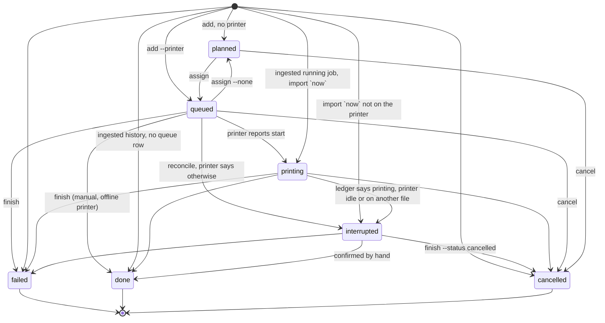

# Print queue: one view over queue, job history, printer status and filament accounting

Date: 2026-10-30
Status: spec, not implemented
Tickets: [#170](https://github.com/alex-mextner/3d-cli/issues/170) (fleet job ledger + history ingestion),
[#171](https://github.com/alex-mextner/3d-cli/issues/171) (queue enqueue/reorder/assign + babushkin-dom import).
Consumers that wait for this: [#361](https://github.com/alex-mextner/3d-cli/issues/361) (TUI print and queue section),
[#173](https://github.com/alex-mextner/3d-cli/issues/173) (HA `sensor.printops_queue_<printer>`).
Parents: epic [#154](https://github.com/alex-mextner/3d-cli/issues/154), `docs/printops/plan.md` §5.2, §5.4, §11.1, §14.4, ROADMAP §31.

## 1. The question that started it

"How do I look at the print queue?" and "does a worktree/branch/task for it exist?"

- Today the only queue view is per printer and read-through: `3d printers show NAME` prints the
  printer's own queue (Moonraker `GET /server/job_queue/status`) and its last jobs
  (`/server/history/list`). `creality-stock` prints `n/a (…does not expose a queue)`.
  There is no fleet-wide queue, no job ledger, no link from a job to the spools it burns, no
  `3d queue`/`3d printer queue`.
- No worktree, no branch and no task did the queue itself. #170 and #171 are OPEN and unstarted:
  `lib/printops/migrations/` has no `job`/`job_tool`/queue table, `lib/printops/api/` has no
  `/v1/jobs` or `/v1/history`, `lib/printops/cli/` has no `queue` sub, there is no `import-queue`
  and no `queue_report.py` in this repo (checked at `f3d8aa3f`). #453 (the `printers show` dossier)
  is closed and is the base this spec builds on.

## 2. Owner decisions (2026-10-24 session, answered in the scoping question)

| Question | Decision |
|---|---|
| Scope | One spec for the whole of #170 + #171 + the read view. Delivered as the slices of §10, not one PR. |
| Surface | Both: top-level `3d queue` (fleet) and `3d printer queue [NAME]` (one printer, next to `printer status`). |
| Offline | Original requirement: `3d printer status` and the other commands must keep working when a printer is offline; the unavailable part of the data is skipped, the rest is shown. |
| D7 (plan, decided) | Other people's printers (`access: offline`) are never contacted; their jobs and usage are entered by hand. |

## 3. Goals and non-goals

Goals

1. One data model for jobs: the queue, the history of what ran, and the plastic each job used
   (`job` + `job_tool` tied to `ledger`/spools). A job is one row from "planned" to "done".
2. One view of it, per printer and for the fleet, in one command, with the printer's live status
   and the spool/material check next to each queued job.
3. Every read command survives an unreachable printer and an unreachable 3d-api: the failed part is
   reported with its reason, everything else is printed, exit code 0 (§7).
4. Queue edits (add, reorder, assign, cancel) and the babushkin-dom import, exactly as #171 states.

Non-goals

- The queue never writes to hardware. It does not start, cancel or upload. `3d printer start`
  stays the only start path with its preflight gate and `--yes` (AGENTS.md "Command surface").
  `3d queue next PRINTER` prints the head job and the exact `3d printer start` command to run.
- No scheduler/auto-assign by capability (ROADMAP §31 "Multi-printer / queue" stays a later item);
  `assign` is explicit. `requires` (§4.1) is stored so a later auto-assign has input.
- No writes into a printer's own Moonraker queue. It is shown, not managed.
- No Bambu/other-people's-printer ingestion (D7).

## 4. Data model

New migration `lib/printops/migrations/0110_jobs.sql` (next free number after `0100_settings_history`).

### 4.1 `job`

| Column | Notes |
|---|---|
| `id` INTEGER PK | |
| `uid` TEXT UNIQUE NOT NULL | client-generated; makes `add` and the offline buffer replay idempotent (same pattern as `history_buffer.py`) |
| `printer` TEXT NULL | fleet printer name; NULL = planned, not assigned |
| `status` TEXT NOT NULL | `planned`, `queued`, `printing`, `done`, `failed`, `cancelled`, `interrupted` (§4.3) |
| `queue_rank` INTEGER NULL | position in that printer's queue, 1 = next; NULL unless `status = queued`. Dense per printer, compacted in the same transaction on every reorder and every transition out of `queued` |
| `file`, `local_path`, `artifact_sha256` | `file` as the printer sees it, `local_path` of the artifact `queue next` starts from (NULL for native-adopted), sha256 of the G-code or 3MF when known |
| `source` | `3d`, `slicer`, `touchscreen`, `cloud`, `manual`, `import` (plan §5.2 plus the two this spec needs) |
| `printer_job_id` TEXT NULL | the printer's own id (Moonraker job id, `000070`); `UNIQUE(printer, printer_job_id)` where not NULL; set when sync links the printer's job, so re-ingestion never duplicates |
| `import_key` TEXT NULL | `babushkin:<hash>` of the `import-queue` entry (§6.4); globally `UNIQUE` where not NULL, independent of `printer` so assigning/starting does not change it |
| `queued_at`, `started_at`, `ended_at` | UTC ISO |
| `attempt_of` INTEGER NULL → `job.id` | a reprint after a failure |
| `order_ref`, `note`, `actor` | free text; `actor` as in the other printops tables |
| `requires` JSON NULL | min bed, nozzle, per-tool material/colour; input for the material check (§6.3) and for later auto-assign |
| `est_s` INTEGER NULL | slicer print-time estimate |

### 4.2 `job_tool`

`PRIMARY KEY (job_id, tool, segment)` (segment 0 unless the spool was replaced mid-print, e.g. paused swap);
columns `slot`, `spool_id`, `material`, `g_est`, `g_reported`, `mm_reported`, `mm_total` (per job, as
`exposure.py` parses it), `ledger_id` (the ledger row booked for this segment, NULL until booked), `booked`
(`NULL | booked | skipped`).

Estimated and observed plastic stay separate (plan §5.3 item 3):

- `g_est` = slicer estimate (G-code footer / Moonraker `filament_weights` / 3MF). It is an estimate, never a fact.
- `g_reported` / `mm_reported` = what the printer says it used. Used grams for the ledger are
  `g_reported` if present, else `g_est × mm_reported / mm_total` (the rule `exposure.py` already
  applies), else `g_est` only for a job that finished `done`. A job that ends `failed`/`cancelled`
  with no reported usage books nothing and leaves a `note` ledger row: "cancelled on layer 1 does
  not debit the full estimate".
- Booking writes one `ledger` row per tool segment with `job_id = "job:<id>"` (prefixed so it cannot collide with
  the printer-style ids of `spool use --job`), `source` ∈
  `moonraker_live | printer_reported | gcode_estimate | manual` and the matching `confidence_g`. The check
  `ledger_id IS NULL`, the ledger insert and `job_tool.ledger_id` run in ONE `BEGIN IMMEDIATE` transaction:
  `ledger.book` (which opens its own non-reentrant `db.transaction`) gets an inner variant taking the open
  connection. A second attempt is a no-op. `ledger.job_id` stays free text (no FK), as in `0020_spools.sql`.
- Zero grams (unused tool footers show `0.00`) and an unresolved `spool_id` (ledger.spool_id is NOT NULL)
  book nothing and set `job_tool.booked = 'skipped'` with a reason, so sync does not retry them and no
  note row is appended twice. The note row for failed/cancelled jobs is written once, guarded the same way.
- Moonraker-written usage: for a printer whose usage Moonraker books itself (K1 SE with `[spoolman]`), a
  ledger-only row is written (local estimate drops, no Spoolman `/use`), so Spoolman is not debited twice.
- Anchor guard: `ledger.estimate` takes deltas by insertion id after the newest anchor, so a delayed booking
  would be subtracted from a weighing that already includes it. Book only when `job.ended_at` is later than
  the spool's newest anchor `at`; otherwise write a `note` row and no delta. The first `jobs sync` and every
  `done` job created by the import never book (cutover: only jobs ended after the first sync's start book).

### 4.3 Status machine



`done`, `failed`, `cancelled` are terminal. A reprint is a new job with `attempt_of`. Every transition
appends an event (`job.queued`, `job.started`, `job.finished`, `job.failed` per plan §11.2, plus
`job.reordered`, `job.assigned`, `job.cancelled`) to the existing `events` table.

### 4.4 Relation to `exposure`

`exposure` (migration `0060_incidents`) already records one immutable row per job×head from Moonraker
history for incident analysis, with `source = 'job'` reserved for #170. Keep it untouched: it answers
"what plastic touched this head", `job_tool` answers "what did this job cost". Ingestion (§5) reuses
`exposure.sync_moonraker`'s history parsing through one shared function so grams are computed once, by
one rule. No second parser.

## 5. Ingestion (#170)

| Printer | Source of truth | How |
|---|---|---|
| U1 and other Moonraker printers | `/server/history/list` (+ `/server/job_queue/status` for what waits on the printer) | `3d printops jobs sync [PRINTER]` and the same function on a 3d-api timer; idempotent by `(printer, printer_job_id = Moonraker job_id)` |
| K1 SE (`moonraker` since #221; `creality-stock`, ws :9999 only as a hand-set fallback) | Moonraker history as the U1 row. Fallback only: live `status()`, the adapter has no history/queue | Moonraker `[spoolman]` books the K1 SE usage itself (single-writer rule, `head_sync.py`, `docs/printops/oss.md` §9.6), so its jobs use the ledger-only booking of §4.2. For the creality-stock fallback the watcher (`printer_ops/watch.py`) writes the job from start/end transitions; slice S3 first reads what the status frame carries; without a used-length, usage is `g_est` only and labelled so. [INFERENCE: not verified against a K1 SE frame] |
| `access: offline` (P1S, A1 mini, …) | nobody | `3d printops jobs add --manual` / REST / bot; D7 |
| A job started on the printer's touchscreen or sent from a slicer | the printer's history | ingested as `source = touchscreen`/`slicer`; it moves a queued job to `printing` instead of duplicating only if the job is `queued` on that printer, the history entry started at or after the job's `queued_at`, and the file matches by the `<sha16>` tag in the remote name (`<stem>-<sha16>.gcode`, `lib/printer_ops/base.py`) or by exact `(printer, file)`; among identical candidates the lowest `queue_rank` wins. Anything older is plain history |

Durable intent (#68) vs live state: `3d printops jobs reconcile` (also run after every sync) compares
`printing`/`queued` rows with what the printer reports. Mismatches become `interrupted` or an
`anomaly` row (the existing `0030_reconcile` mechanism), never a silent rewrite.

Native-queue divergence: a job in the printer's own Moonraker queue that has no `job` row is shown
in the view as `native only` and offered for adoption (`3d queue adopt`), not auto-created.

## 6. Commands

One implementation module `lib/printops/cli/queue.py` (self-registering `SUB`, stdlib-only top level,
heavy imports lazy). Three entry points share it so there is one behaviour:

- `3d queue …` — `lib/commands/queue.py`, group "SLICING" (where `printer`/`printops` already are), the user-facing command.
- `3d printer queue [NAME] …` — sub of `printer`, same code with the printer fixed.
- `3d printops queue …` and `3d printops import-queue …` — thin subs forwarding to the same
  `run`, so the acceptance text of #171 holds literally.

### 6.1 Read

```
3d queue [show] [PRINTER ...] [--all] [--status S,...] [--history N] [--since DATE] [--no-live] [--strict] [--json] [--secs N]   # subcommand names win over a printer of the same name; use `3d printer queue NAME` for that printer
3d printer queue [NAME] [same flags]
3d queue job ID [--json]                           # one job: tools, spools, ledger rows, events
3d queue next PRINTER                              # head job + the exact `3d printer start` line using the job's stored local path; no hardware write. A job without a local file (native-adopted) prints "no local artifact: bind with `3d queue adopt PRINTER FILE --local PATH`" and exits 1
3d queue report [--out DIR]                         # replaces gen/queue_report.py: QUEUE.md, plates table, shopping_list.md from the ledger
```

Default `3d queue` = every fleet printer that is not `access: offline` plus a block of unassigned
(`planned`) jobs; with `--all` offline printers are listed with their manually entered jobs and never contacted.
`--all` includes finished jobs beyond `--history N` (default 5, same cap and validation as
`printers show --history`).

Text layout, per printer (illustrative):

```
u1   printing  "bracket_v3.gcode"  layer 112/340  41%  ~1h 12m left       [live ok]
     spools   T0 PLA white 412 g   T1 PETG black 88 g   T2 -   T3 PLA red 190 g
     queue    1. clip_x4.gcode      PLA white  42 g   ok
              2. cover.gcode        PETG black 96 g   SHORT: need 96 g, T1 has 88 g
              3. (native only) test.gcode                 adopt: 3d queue adopt u1 test.gcode
     history  #70 done  bracket_v2   2h 03m   38 g     #69 failed  cover  0h 14m  2 g (cancelled)
k1se unreachable: connection refused (192.168.0.x:9999)   [live unreachable]
     queue    1. gear.gcode         PLA grey   18 g   unknown (printer not read)
p1s  never contacted (offline fleet printer)             [manual jobs only]
     history  #41 done  vase  3h 10m  55 g   (manual)
unassigned   2 jobs: lamp_base.gcode, lamp_top.gcode      (3d queue assign JOB PRINTER)
```

`--json` is `{printers: [{name, machine, live, native_queue, jobs, spools, history}], unassigned: [...], ledger: {...}}`,
every part carrying `status` (`ok | unreachable | unsupported | skipped`) and `note`/`error`, the
vocabulary and shape of `printers show --json` (`printer_ops/dossier.py` `_section_json`).

### 6.2 Write (#171)

```
3d queue add FILE [--printer P] [--first | --after JOB | --before JOB] [--qty N] [--material T0=PLA,T1=PETG] [--order-ref R] [--note T] [--uid U] [--json]   # --first/--after/--before need --printer; --qty N derives uids as `<U>-1..N`
3d queue reorder JOB (--first | --last | --before JOB | --after JOB | --to N)
3d queue assign JOB PRINTER | --none
3d queue cancel JOB [--note T]                      # `queued`/`planned` only; a `printing` job is refused (stop it on the printer, sync records the end and books the plastic)
3d queue adopt PRINTER FILE
3d queue finish JOB --status done|failed|cancelled [--g T0=38.2,...] [--ended DATE]    # manual jobs (offline printers); also confirms an `interrupted` job. Never edits an already booked job: a correction is a new `manual` ledger delta
3d printops import-queue --queue gen/queue.json [--plates gen/plates.json] [--dry-run] [--json]
```

Rules: `reorder` accepts only `queued` jobs, `assign` `planned`/`queued` ones (a `planned` job has no rank); `printing`/terminal jobs are refused with exit 1 and the
reason. `add FILE` takes the sha256 and, when the file is a G-code/3MF with a footer, fills `g_est`, `est_s`
and per-tool `material` from it. `--qty N` creates N jobs with distinct `uid`s. Assigning to an
`access: offline` printer is allowed (manual queue); assigning to an unknown printer is exit 2.
Mutations are single transactions; every transition out of `queued` (start, cancel, assign, finish)
compacts `queue_rank`, so it stays dense and unique per printer (property tested, §9).

### 6.3 Material check

For each `queued` job on a printer with known slots: per `job_tool`/`requires`, compare needed grams
with the estimate of the spool loaded in that slot (`ledger.estimate()` from the local ledger, no Spoolman
call, so a Spoolman outage degrades to `unknown` per job, never fails `/v1/queue`; an unweighed spool is
`unknown`, not `SHORT`), and the material and
colour with what `requires` asks. Result per job: `ok`, `SHORT: need X g, slot has Y g`,
`MISMATCH: wants PETG, slot T1 has PLA`, or `unknown (printer not read | no slot data)`. The check is
advisory; the real gate is `print-preflight`/`printer start`. Queue totals by material feed
`queue report` (shopping list = demand − stock, plan §11).

### 6.4 Import mapping (`import-queue`)

Checked against the real `~/xp/garage-band/projects/babushkin-dom/gen/queue.json` (4 printers, 35 entries; each
entry has `file`, `load`, `status`, `what`). Its statuses and what each becomes:

| queue.json status | n | `job.status` | Notes |
|---|---|---|---|
| `printed` | 17 | `done` | `source = import`; usage from the G-code footer when the file is found, else no `job_tool` usage. Imported jobs NEVER book the ledger: `plates.json` `owned` is already net of them and `import-owned` anchors from it (§4.2 cutover) |
| `queued` | 6 | `queued` | order = position in `entries`; `queue_rank` follows it |
| `deferred` | 7 | `planned` | not assigned to run now; keeps its printer in `printer` only as a hint in `note` |
| `cancelled` | 3 | `cancelled` | books nothing |
| `now` | 1 | `printing` only if the printer's live status shows that file, else `interrupted` | the file may be stale; reconcile decides |
| `tester` | 1 | `planned` + `order_ref = tester` | calibration tester print, kept out of material demand totals |

`load` (e.g. `{T1: "синий"}`) becomes `job_tool.material`/colour hint, resolved to a spool only when exactly
one owned spool matches; otherwise left unresolved and listed in the `--dry-run` report. Spools come from
`plates.json` `owned` through the existing `3d printops spool import-owned` path (not a second importer).
Idempotency uses two separate keys, see §4.1: `import_key = babushkin:<sha1(file|what|status)>` (content, not
list position, so a new entry at the top does not re-import the rest; duplicates of one content get a `#n`
suffix in file order) is globally `UNIQUE`, also for the `printer = NULL` rows. The count reconciliation prints
per status and per printer: 35 in, 35 jobs out, with the mapped totals above for this file.

### 6.5 Exit codes

0 ok, including when some sections are `unreachable`/`skipped`/`unsupported`; 2 usage/unknown printer/job
(`InvalidArgument`/`InputNotFound`); 1 `GateFailure` for a refused mutation; with `--strict` 1 if any
selected section is `unreachable` (`access: offline` and `unsupported` sections are expected, not failures,
so the real fleet with four offline printers can exit 0). Errors use `lib/errors.py`, no ad-hoc `sys.exit`.

## 7. Offline tolerance

The degradation unit is the **section**, not the command. Reuse the dossier vocabulary
(`printer_ops/dossier.py`: `OK / UNREACHABLE / UNSUPPORTED / SKIPPED`, `Section`, `_section`, `_reason`).

| Condition | What is printed | Exit |
|---|---|---|
| Printer unreachable | its `live`/`native_queue` sections `unreachable: <reason>`; ledger-backed `jobs`, `spools`, `history` still shown from 3d-api, marked "last known" | 0 |
| `access: offline` printer | live sections `never contacted`; manual jobs shown | 0 |
| `creality-stock` | `n/a (creality-stock adapter does not expose a queue)` for the native queue; ledger jobs shown | 0 |
| 3d-api unreachable | printer-native sections as today; `ledger: unreachable: <reason>`; spool/material check `unknown` | 0 |
| 3d-api unreachable, `queue add` | job written to the single buffer `<data_dir>/printer-queue/pending.jsonl` (flock + fsync, idempotent by `uid`, one file so an add without `--printer` is buffered too; mechanics of `printops/history_buffer.py`, except a refused line is moved to `rejected.jsonl` instead of blocking later lines; replay appends under the same lock, truncating only what it consumed) and replayed on the next reachable call; `--after/--before JOB` that no longer applies at replay falls back to the end of the queue with a note; the output says "buffered" | 0 |
| 3d-api unreachable, `reorder`/`assign`/`cancel`/`finish` | refused, the reason names the missing 3d-api and that these edits are api-only | 1 |
| Both down | static facts (model, fleet entry) plus both reasons | 0 |

`--no-live` skips every printer read (same flag as `printers show`). A dead host costs one timeout, not
one per section: sections are read concurrently as `dossier.collect` does today.

### 7.1 `printer status` becomes offline-tolerant

`lib/commands/printer.py::_cmd_status` today has no `try/except`: an unreachable printer raises
`PrinterCommError` and the dispatcher exits 1 with an empty stdout, an offline fleet printer raises
`PrinterRefused`. Change (slice S1, independent of the ledger):

- Extract `Section`, the four status constants, `_section`, `_reason` from `dossier.py` into
  `lib/printer_ops/sections.py`; `dossier.py` imports them (clean cutover, no copy).
- `printer status NAME`: build the live section through `_section`. Reachable → output unchanged.
  Unreachable → static facts (`printer list` row), `live: unreachable: <reason>`, plus the last known
  job/spools from 3d-api when reachable (slice S5; S1 prints the static facts and the reason only);
  exit 0. Offline fleet printer → `never contacted`, exit 0.
  `--strict` restores exit 1 for scripts. `--json` gains `live.status`/`live.error` (additive).
- Only the live read moves inside `_section`. Building the adapter (`_adapter`/`get_device`) stays outside
  it, because `_section` swallows every `ThreeDError`: unknown printer, "no printers configured" and a bad
  device config keep exit 2.
- The exit-code change is a behaviour change. Callers checked: `lib/printer_ops/printer_agent.py`,
  `subscriptions.py`, `watch.py`, `moonraker.py`, `creality.py`, `library/capture.py`, `bed_photo.py`
  only print `` `3d printer status NAME` `` as a hint for a human or agent to run; none inspects its
  exit code. `printer status` with several names or `--all` (fleet loop) is added in the same slice so
  "other commands" like `printer list`/`status` share one tolerant path. Update `docs/commands/printer.md`
  (exit-code section, line "1 … or printer unreachable") and its `--help`.

## 8. REST (3d-api)

Routers `routes_jobs.py` (new) in `lib/printops/api/`, wired in `app.py`, auth like `routes_spools.py`
(read endpoints need the read scope, mutations the write scope).

```
GET    /v1/jobs?printer=&status=&since=&limit=     list (queue order for queued)
POST   /v1/jobs                                    create (idempotent by uid)
GET    /v1/jobs/{id}                               job + tools + ledger rows + events
PATCH  /v1/jobs/{id}                               printer, position {first|last|before|after|to}, status (manual finish), usage
POST   /v1/jobs/{id}/finish                        manual end with usage (books the ledger)
GET    /v1/history?printer=&since=&limit=          finished jobs (#170 acceptance)
GET    /v1/queue                                   the fleet queue + material check, the JSON the CLI view, TUI (#361) and HA (#173) share
POST   /v1/jobs/sync                               ingest from the printers now (body: printers[])
```

`POST /v1/jobs/{id}/preflight` and `/start` from plan §11.1 stay out: `printer start` owns them (§3).
`ApiClient` gains `jobs_*` methods; no new transport.

## 9. Acceptance and tests

The user-visible bar (AGENTS.md "Testing"): every command/flag has an e2e through `bin/3d`, using the
loopback fakes in `tests/printer_fakes.py` and the injected-ssh/api fakes the printops tests already use;
nothing talks to a real printer or the Odroid.

Behaviour that must be pinned (each with a version of the test that can FAIL):

1. #170: for a fake U1 history with one `done`, one `cancelled` mid-print and one `failed`, `jobs sync`
   creates three `job` + `job_tool` rows, books ledger rows by the §4.2 rule (the cancelled job debits
   the scaled amount, not `g_est`), and a second `sync` changes nothing (row counts equal, ledger sum equal).
2. `GET /v1/history?printer=u1&since=…` returns exactly the jobs after `since`.
3. Manual job for an `access: offline` printer: `queue add --printer p1s` then `finish --g T0=55`
   books the ledger and the printer is never contacted (the fake records zero connections).
4. #171: `add`/`reorder`/`assign` keep `queue_rank` dense and unique per printer for any sequence
   (property test over random op sequences); reordering a `printing` job is refused.
5. `import-queue` on a fixture `queue.json` + `plates.json`: job count by status and spool count equal
   the fixture's (the "without loss" check from #171, compared by counts); `--dry-run` writes nothing;
   a second run is a no-op.
6. `queue report` on the imported fixture reproduces the three outputs of the real
   `babushkin-dom/gen/queue_report.py` (`print/QUEUE.md`, the README plates table, `docs/shopping_list.md`):
   the fixture is a copy of that project's `queue.json` + `plates.json` + the G-code footers it reads, the golden
   is the output of running the old script on that copy, and the test compares per-printer times, grams per
   spool and the shopping list totals (#171: "the same result as before"). Prose lines may differ; numbers may not.
7. Offline matrix of §7, one test per row: unreachable printer, `access: offline`, creality-stock,
   3d-api down (read, buffered `add`, refused `reorder`), both down; each asserts exit code, which
   sections are present and that the others still render.
8. `printer status` against an unreachable fake: exit 0 with `live: unreachable`, exit 1 with `--strict`,
   exit 2 for an unknown name, for "no printers configured" and for a bad device config; an offline fleet
   printer exits 0 (the pinned `test_contacting_an_offline_printer_is_refused` and
   `docs/commands/printer.md` exit-code line are updated in the same commit); reachable output
   byte-identical to today's golden.
9. A start observed on a printer for a file matching a queued job moves exactly one job to `printing` and
   does not create a duplicate; the remote name `clip-<sha16>.gcode` (what `printer upload` writes)
   matches a job added as `clip.gcode`; a completed history entry older than the job's `queued_at` does
   NOT match it; with `--qty 4` the lowest `queue_rank` moves.
10. Delayed ingestion: a spool weighed at 900 g, then a job that ended before the weighing synced afterwards:
    the estimate stays 900 g (note row, no delta). A job ended after the weighing books and lowers it.
11. Moonraker-written usage (K1 SE with `[spoolman]`): sync books a ledger-only row, Spoolman `/use` is
    called zero times, the local estimate drops by the job's grams.
12. Spool swapped mid-print on one tool (20 g from spool A, then 30 g from spool B): two segments, two
    ledger rows, each spool debited its own grams.
13. Manual `queued -> done` on an offline printer, `finish` on a `printing` job, `cancel` of a `printing`
    job refused, and rank compaction after every transition out of `queued`.

Docs in the same commits as code: `docs/commands/queue.md` (new), `docs/commands/printops.md` (queue,
jobs, import-queue rows), `docs/commands/printer.md` (`queue`, status exit codes), `docs/commands/printers.md`
(pointer to `3d queue`), `--help` strings in the same commit (help-docs-sync), `docs/printops/plan.md` §14.4 note that the queue moved
into PrintOps, `docs/architecture/lib-map.md` if the repo keeps it generated.

## 10. Slices (each its own worktree/PR, ordered by dependency)

| Slice | Content | Depends on |
|---|---|---|
| S1 | `printer_ops/sections.py` extraction, offline-tolerant `printer status` (+ fleet form) without the 3d-api "last known" block, docs, test §9.8 | — |
| S2 | `0110_jobs.sql`, jobs repository, status machine, ledger booking (§4.2: ledger-only variant, anchor guard), `/v1/jobs`, `/v1/history`, `ApiClient` methods (#170 core) | — |
| S3 | Ingestion: shared history parser with `exposure`, `jobs sync`, reconcile, creality-stock watcher hook (fallback adapter only), manual `finish` (#170 rest) | S2 |
| S4 | Queue writes: `add/reorder/assign/cancel/adopt`, local buffer, `printer start` ↔ job linkage (#171 core) | S2 |
| S5 | The view: `3d queue`, `3d printer queue`, material check, `/v1/queue`, `queue next`, `queue report`, the 3d-api "last known" block of `printer status`, offline matrix test §9.7 | S1, S2, S4 (buffered `add` and refused `reorder` rows of §9.7; renders with an empty ledger) |
| S6 | `import-queue`, golden for `queue report`, retire `queue_report.py` usage (#171 rest) | S4, S5 |

S1 and S2 start in parallel. Hooks for #361 (TUI) and #173 (HA) are `GET /v1/queue` only; their own
tickets implement the clients.

## 11. Risks

- Booking plastic twice (ingestion and manual finish racing): guarded by `job_tool.ledger_id` set in the
  same transaction as the ledger row; test 1 repeats `sync` after a manual finish.
- Two parsers diverging on grams (`exposure` vs `job_tool`): one shared function (§4.4).
- `printer status` exit-code change surprising a script outside this repo: mitigated by `--strict`
  and the docs line; noted in the changelog entry.
- K1 SE usage may be estimate-only (§5): labelled by `source = gcode_estimate`, never presented as observed.
- The status vocabulary is new (plan §5.2 gives none): this spec fixes it in §4.3; changing it later
  needs a migration.
