# Верхняя камера C920 для K1 SE и Snapmaker U1 — целиком из пластика

Один держатель на оба принтера, **без единого винта, гайки, пружины и металла**. Logitech C920 смотрит вниз на центр стола. Держатель ставится без инструментов примерно за минуту и каждый раз встаёт в то же положение. Тикет: [#338](https://github.com/alex-mextner/3d-cli/issues/338). Нужен для калибровки по фото: [#273](https://github.com/alex-mextner/3d-cli/issues/273), эпик [#268](https://github.com/alex-mextner/3d-cli/issues/268).

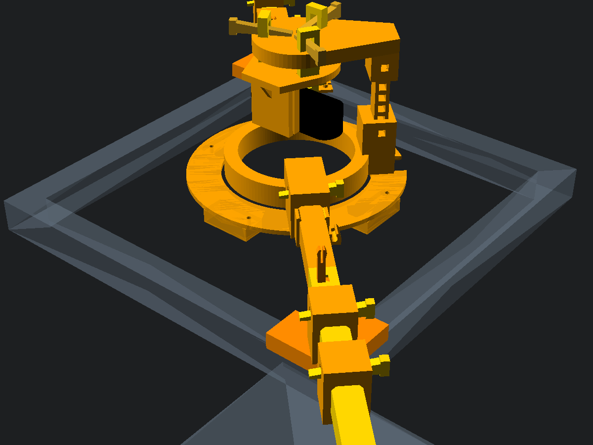

## 1. Как это устроено

- **Мост.** Печатная балка 20×20 лежит **по диагонали** на верху принтера: из заднего левого угла в передний правый. В каждой половине два сегмента: короткий `beam_a` и длинный `beam_b`, оба помещаются на стол K1. Сегменты соединяются квадратным шипом 12×12 на 25 мм с посадкой 0.12 мм на сторону и фиксируются защёлкивающимся штифтом.
- **Ножки и башмаки.** На балке четыре ножки, по две на каждый принтер. Ножку один раз фиксируют **клином**: печатный клин 1:7.5 вдавливается поперёк ножки над балкой и прижимает балку в V-ложе. Клин держится сам: угол 7.6° меньше угла трения PLA. Под ножкой квадратный шип, на него снизу надевается **башмак**:
  - **K1 SE:** губки башмака опускаются во **внутренний угол** верхней рамы.
  - **U1:** колышек опускается в **силиконовую подушку**, в те же гнёзда, куда садится крышка Top Cover.

  Две противоположные опоры не дают мосту ни сдвинуться, ни повернуться.
- **Смена принтера.** Снимите одну пару башмаков (просто тянуть вверх) и наденьте другую. Ножки и клинья остаются на месте, поэтому положение камеры сохраняется.
- **Хаб.** Хаб соединяет половины балки вокруг **открытого окна Ø100** (каждая половина зажата своим клином). Высота стойки камеры меняется **штифтом-защёлкой**, отверстия идут через 10 мм.
- **Наклон.** Пластина камеры **висит на трёх подвесах**. Подвес — это печатная планка с Т-головкой под пластиной. Она проходит сквозь пластину и кронштейн, а над кронштейном опирается на **клин**. Вдвигая клин, поднимаете свой угол пластины: 1 мм хода клина даёт 0.13 мм подъёма, полный ход 6 мм. Пружины не нужны, пластину прижимает её собственный вес вместе с камерой. Вес же возвращает её в то же положение.
- **Камера.** **Штатная клипса** C920 вдвигается сверху в печатный паз на лапке: две направляющие с губками и два упора внизу. Винт 1/4" не нужен. Камеру держит вес, а упоры и направляющие каждый раз ставят её в одно место.
- **Опции.** Лоток для Pi Zero W на защёлке, клипсы для кабеля, кольцо с 4 рассеянными светодиодами на печатных штифтах.

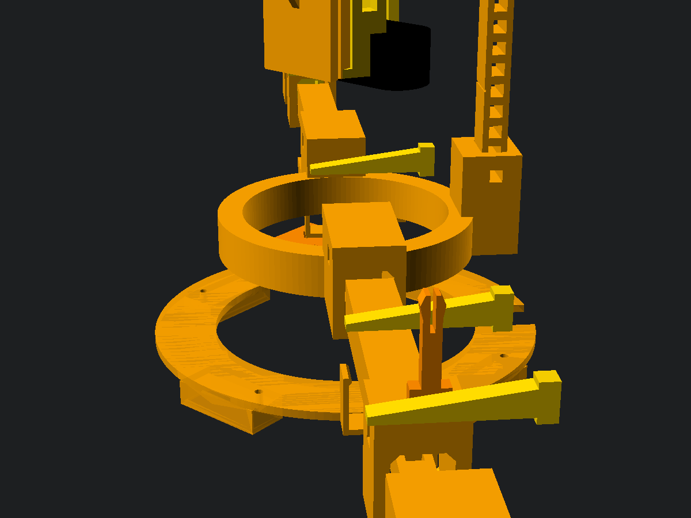
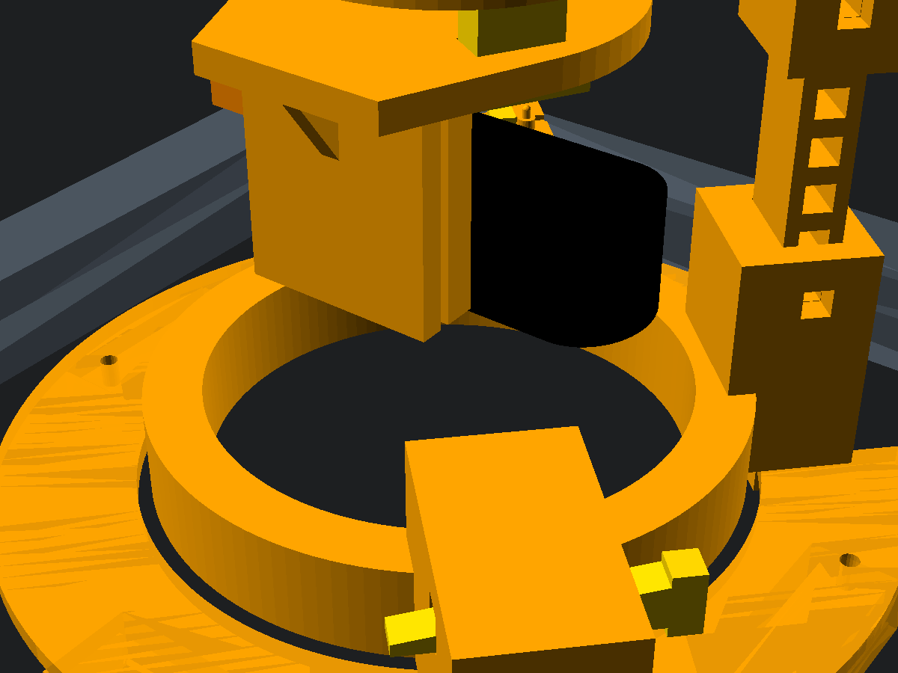

**Прогиб балки.** Модель считает его сама и выводит в лог: `ECHO: beam: …`, а `assert` не пропустит прогиб больше 2 мм.

Исходные данные:
- нагрузка в центре 3.7 Н: C920 162 г, стойка, кронштейн и пластина ~150 г, LED-кольцо ~60 г;
- пролёт — между подушками U1 (на K1 он короче), 587 мм;
- сечение: 4 стенки (1.8 мм) + 25 % заполнения, I ≈ 8 800 мм⁴;
- модуль упругости печатного PLA E ≈ 2 500 МПа (нижняя оценка).

Результат:
- прогиб **≈ 0.9 мм** (δ = PL³/48EI плюс собственный вес);
- напряжение **0.6 МПа**, примерно 1 % от прочности PLA, так что ползучести при комнатной температуре нет.

Прогиб каждый раз одинаковый: груз и опоры те же. Поэтому кадр от него не плывёт, а объектив просто стоит на 1 мм ниже.

**Пластик против металла.** Сравнение по нарезке с теми же пресетами:

| | Металл (v1) | Пластик (v2) |
|---|---|---|
| Печать, с LED-кольцом | 480 г, 14 ч 38 мин | 630 г, 17 ч 41 мин |
| Печать, без кольца | 418 г, 13 ч 07 мин | 567 г, 16 ч 10 мин |
| Покупное | труба 20×20 1 м + распил, 6 болтов M5 и 6 гаек, 5 болтов M4 и 5 гаек, 3 пружины, винт 1/4" | ничего |
| Инструмент при сборке | ножовка и напильник для трубы | нет |
| Сборка | гайки в пазы, головки в барашки | всё на штифтах-защёлках и клиньях |

Пластик тяжелее на ~150 г PLA и печатается на ~3 ч дольше: балка теперь печатная (4 сегмента, ~120 г). Зато ничего не нужно покупать или пилить.

**Высота камеры.** Объектив висит на 64–94 мм над верхом принтера: шаг 10 мм, отверстия стойки 2–5, считая снизу (2 — камера выше всего). Расстояние до стола задаёт **Z стола**. При Z = max до стола около 40 см на K1 SE и около 39 см на U1; это оценка, уточнится после замеров K1-4 и U1-4. Если поднять стол, `расстояние = (верх → стол при Z max) − (Z max − Z) + высота объектива`.

**Окно не попадает в кадр.** Луч от объектива к дальнему углу стола U1 проходит низ хаба внутри окна, а низ LED-кольца — внутри его отверстия. Для каждой высоты это проверяет `assert` в модели, он же гейт `3d check --consistency`.

**Какая повторяемость нужна.** Измерения опираются на фидуциалы на столе (см. `~/.cache/k1-calib/camera-options-ru.md`). Механика должна только держать кадр, фокус и масштаб одинаковыми: это ±0.5 мм и ±0.3°. Две кинематические опоры, посадка под вес на упоры и подвесы на клиньях дают такую точность с запасом.

## 2. Что измерить до печати (сейчас в модели оценки)

Все размеры — параметры `camera_mount.scad`, помечены там `MEASURE`. Пришлите числа, и модель пересоберётся за минуту: `python3 models/camera_mount/build.py -D k1_rim=24 …`.

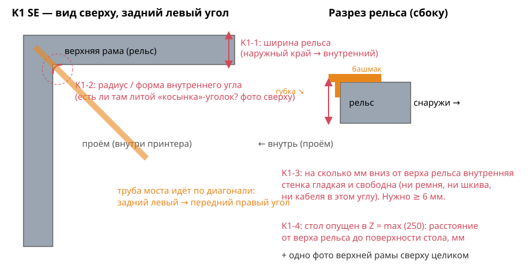

| Код | Что | Параметр | Сейчас (оценка) | Зачем |
|---|---|---|---|---|
| K1-1 | ширина верхнего рельса K1 SE, от наружного края до внутреннего | `k1_rim` | 25 | где внутренний угол |
| K1-2 | радиус или форма внутреннего угла проёма; есть ли литая «косынка» (фото сверху) | `k1_corner_r` | 6 | губки не должны упираться в скругление |
| K1-3 | на сколько мм вниз внутренняя стенка рельса свободна (нет ремня, шкива, кабеля) в заднем левом и переднем правом углах | `k1_lip_depth` | 6 | глубина губок |
| K1-4 | от верха рельса до стола при Z = max (250) | `k1_rim_to_bed` | 340 | расчёт высоты |

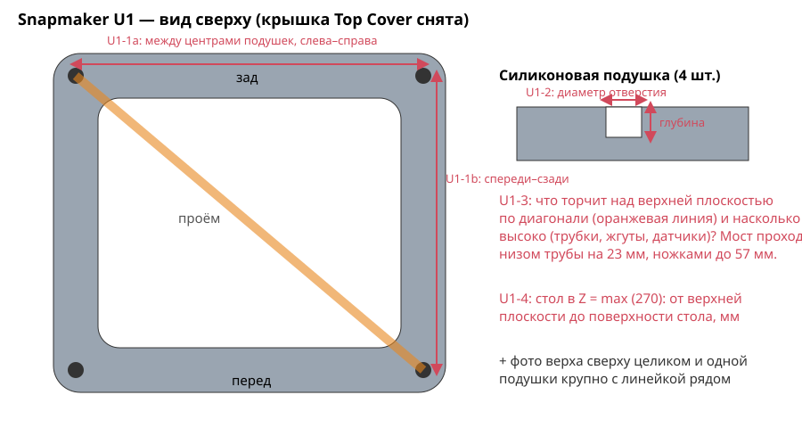

| Код | Что | Параметр | Сейчас (оценка) | Зачем |
|---|---|---|---|---|
| U1-1 | расстояние между центрами силиконовых подушек: слева–справа и спереди–сзади | `u1_pad_dx`, `u1_pad_dy` | 430, 400 | длина балки, угол моста |
| U1-2 | диаметр и глубина отверстия подушки | `u1_hole_d`, `u1_hole_depth` | 8, 6 | колышек: диаметр −0.4 |
| U1-3 | что выступает над верхней плоскостью вдоль диагонали и насколько | — | — | низ балки на 23 мм над ней, ножки и хаб до 57 мм |
| U1-4 | от верхней плоскости до стола при Z = max (270) | `u1_rim_to_bed` | 330 | расчёт высоты |

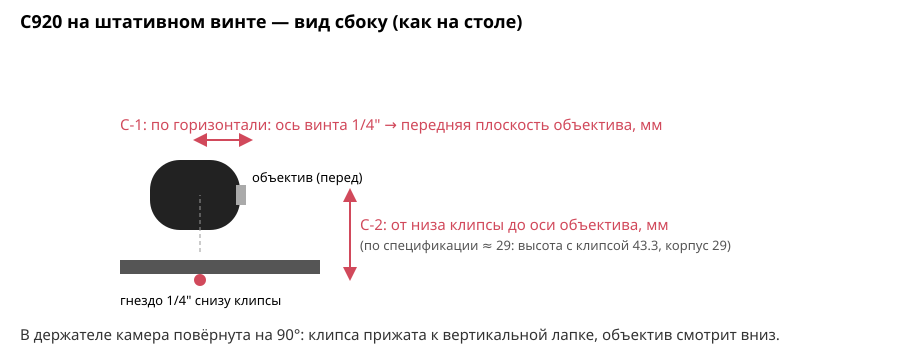

| Код | Что | Параметр | Сейчас | Зачем |
|---|---|---|---|---|
| C-1 | от нижнего края лапки клипсы до передней плоскости объектива (камера висит объективом вниз, лапка вертикально) | `cam_lens_below_floor` | 5 | высота объектива в расчёте |
| C-2 | от плоской стороны лапки клипсы (где гнездо 1/4") до оси объектива | `cam_axis_off` | 29 (по спецификации) | объектив над центром окна |
| C-3 | лапка клипсы с гнездом 1/4": ширина, длина и толщина по краям | `clip_w`, `clip_l`, `clip_t` | 31, 40, 4 | размер паза на лапке |

От замеров зависят только **башмаки K1** (K1-1…K1-3), **колышек U1** (U1-2) и **пластина камеры с пазом** (C-2, C-3). Остальное можно печатать сразу. Зависимые детали лучше печатать после замера: они быстрые, 3 детали по 20–30 г.

## 3. Что купить (Белград)

Для самого держателя ничего покупать не нужно, все детали печатные. Покупать только электронику:

| Что | Кол-во | Примечание |
|---|---|---|
| Raspberry Pi Zero W + microSD 16 ГБ + блок 5 В 2.5 А micro-USB | 1 | Pi Zero W у тебя есть |
| OTG-переходник micro-USB (папа) → USB-A (мама) | 1 | для C920 в Pi Zero, порт USB (не PWR) |
| Резинка для лотка Pi | 1 | любая канцелярская |
| *Опция:* LED-лента 5 В USB, белая, ширина ≤ 12 мм, 4 отрезка по 3 светодиода | ~15 см | [Mikro Princ](https://www.mikroprinc.com/) / любая электроника |
| *Опция:* рассеиватель: опаловый акрил 1.5 мм или калька, 4 полоски 17×44 мм | 4 | в выборку у каждой подушки кольца, на скотч или клей |

## 4. Печать (K1 SE, оранжевый PLA, твои пресеты)

Пресеты: машина `Creality K1 SE 0.4 nozzle - Copy`, процесс `0.20mm Standard @Creality K1 SE - accel 8900`, филамент `Orange PLA @K1SE` (`profiles/snapmaker-orca/`). Для этих деталей поверх процесса: **4 стенки, 25 % заполнения, 5 верхних и 4 нижних слоя**. Настройки калибровки принтера при этом не меняются. Поддержки не нужны.

| Стол | Что на нём | Время | PLA | G-code (K1 SE) |
|---|---|---|---|---|
| 1 `plate_hub` | хаб, стойка, 2 штифта `pin_long`, 4 штифта кольца, 2 клина хаба | 4 ч 49 мин | 159 г | `k1se_camera_mount_plate_hub_orange_pla.gcode` |
| 2 `plate_beam` | 4 сегмента балки, 2 штифта `pin_short`, 3 подвеса, 3 клина наклона | 4 ч 04 мин | 156 г | `k1se_camera_mount_plate_beam_orange_pla.gcode` |
| 3 `plate_small` | 4 ножки, 2 башмака K1, 2 башмака U1, 4 клина ножек | 4 ч 16 мин | 152 г | `k1se_camera_mount_plate_small_orange_pla.gcode` |
| 4 `plate_extras` | кронштейн, пластина камеры с пазом, лоток Pi, 3 клипсы | 3 ч 01 мин | 101 г | `k1se_camera_mount_plate_extras_orange_pla.gcode` |
| 5 `plate_led` *(опция)* | кольцо 4 LED | 1 ч 31 мин | 62 г | `k1se_camera_mount_plate_led_orange_pla.gcode` |
| **Всего** | | **17 ч 41 мин** (без LED 16 ч 10 мин) | **630 г** (без LED 567 г) | |

G-code лежит в `~/.cache/k1-calib/camera-mount/`, файлы металлической версии — в `v1-metal/`.
- Для каждого файла добавлены превью для экрана K1 и записаны предупреждения слайсера.
- Предупреждение Orca про exclude-зону принято: у K1 SE нет зоны исключения на столе.
- `3d print-preflight --printer k1se --offline` (K1 сейчас разобран и не в сети): столы 1, 3, 4, 5 — PASS.
- Стол 2 — WARN: 4 островка по 12 мм² (48 мм² при лимите 100) на потолке гнезда шипа возле отверстия штифта. Это короткие мосты, поддержки не нужны.
- Перед печатью, когда K1 снова в сети, повторить preflight без `--offline`. Взвесить катушку #13: `3d printops spool measure 13 GROSS_G`, нужно ~630 г.

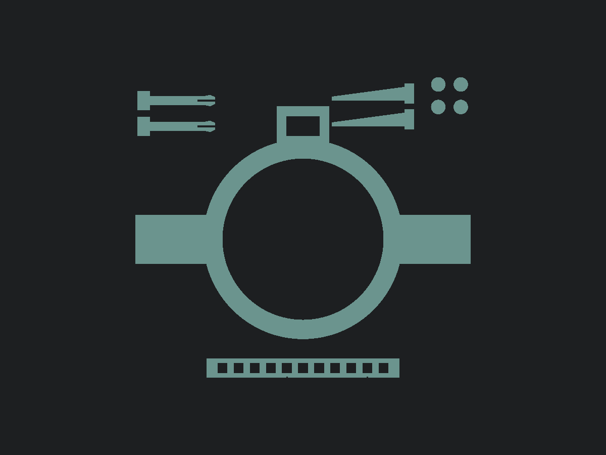 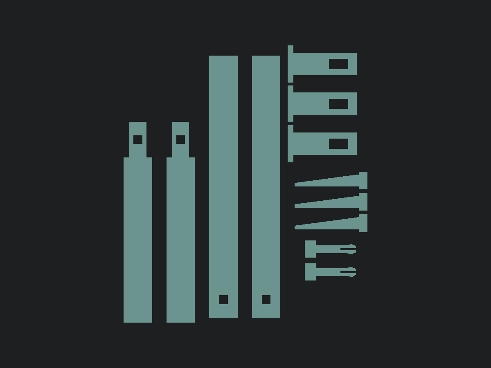
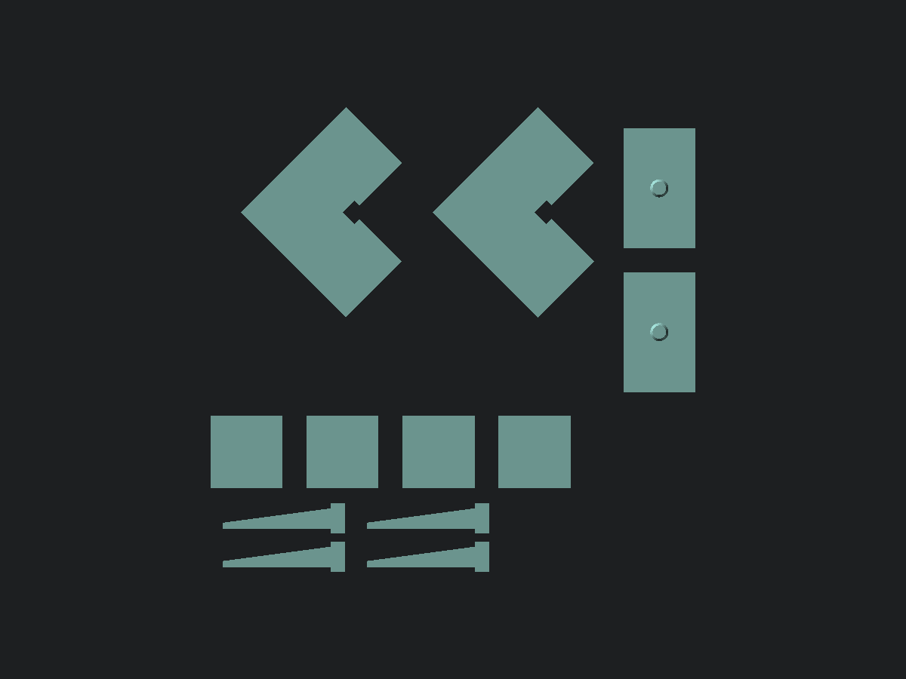 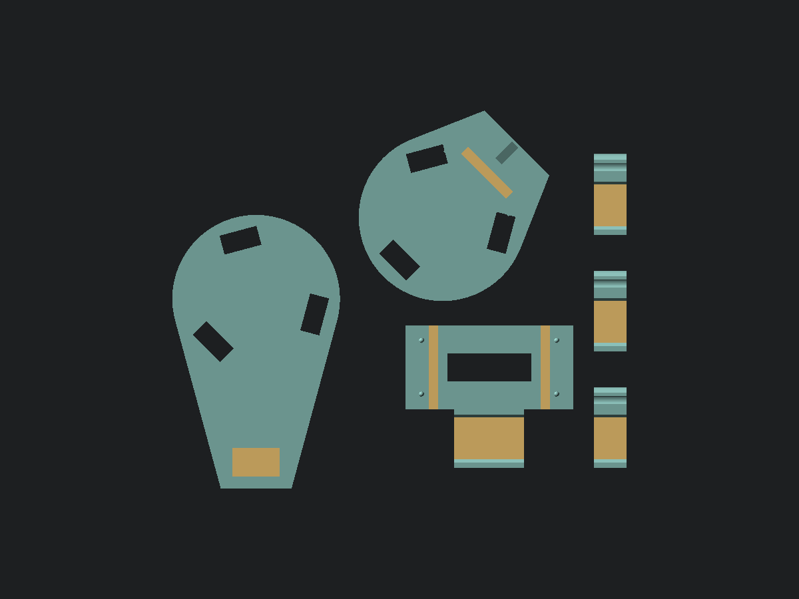 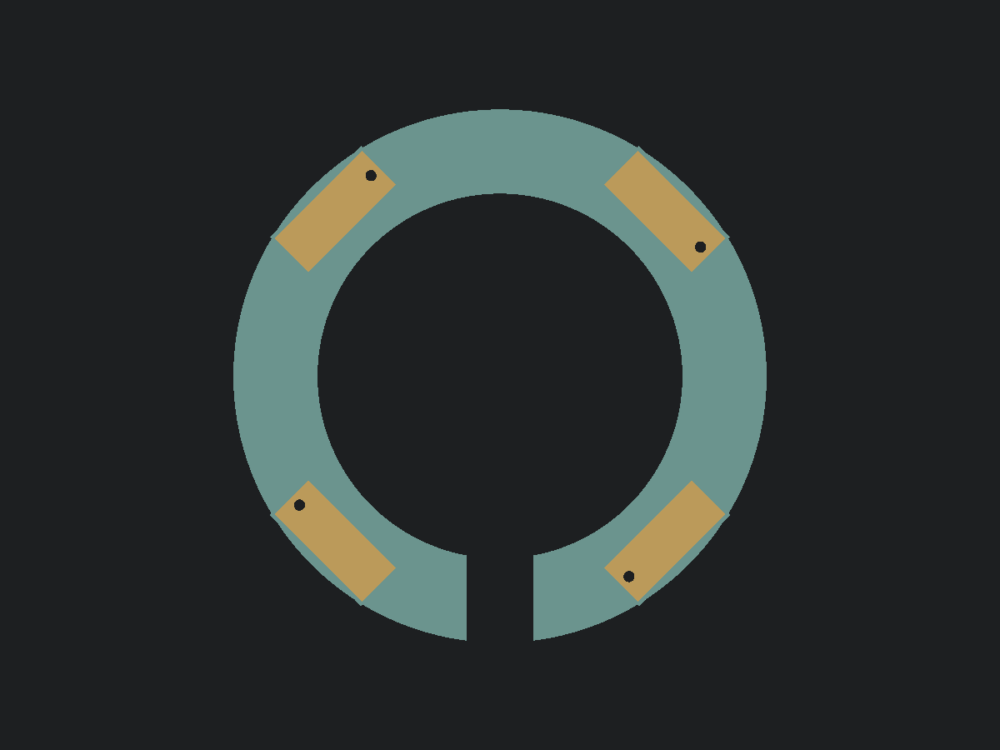

## 5. Сборка (один раз)

1. **Балка.** Вставьте шип `beam_a` в гнездо `beam_b` до упора и сверху вниз продавите штифт `pin_short` через оба сегмента, пока усики не защёлкнутся снизу. Соберите так обе половины.
2. **Хаб.** Вставьте обе половины в хаб коротким сегментом до упора. Вдавите клин поперёк хаба над каждой половиной (в щель над балкой) рукой, до упора.
3. **Ножки.** На каждую половину, начиная с внешнего конца, наденьте ножку K1, затем ножку U1. Клинья пока только вставьте, не вдавливайте.
4. **Стойка.** Вставьте стойку снизу в канал хаба, риски через 50 мм наружу. Продавите штифт `pin_long` через блок хаба и 5-е отверстие стойки снизу (камера в самом низу) до щелчка. Наденьте сверху кронштейн (`arm`) и зафиксируйте вторым `pin_long`.
5. **Наклон.** Проденьте три подвеса снизу через пластину камеры и кронштейн, Т-головкой под пластиной. Над кронштейном вставьте клин в окно каждого подвеса и вдвиньте все три клина одинаково, примерно на середину. Метки оси на кронштейне и пластине должны совпасть.
6. **Камера.** Сложите клипсу C920 так, чтобы лапка с гнездом 1/4" была плоской и параллельной корпусу. Вдвиньте лапку сверху в паз на лапке пластины, плоской стороной к лапке, объективом вниз, до упоров.
7. **Pi Zero W.** Защёлкните лоток снизу на балку примерно в 165 мм от центра хаба. Положите Pi на штыри и прижмите резинкой. C920 подключите через OTG в порт **USB**. Кабели уберите в клипсы.
8. *Опция:* наденьте кольцо светодиодов снизу на хаб на 4 штифта `dowel`.

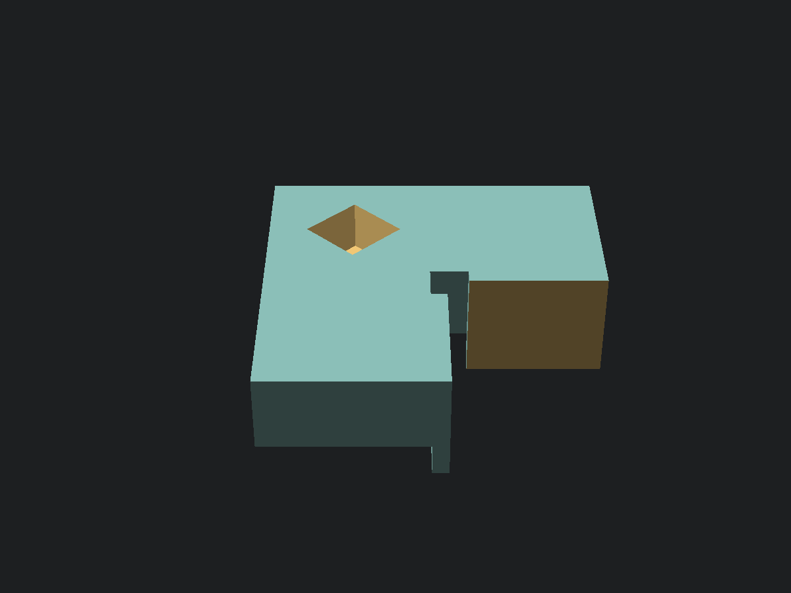 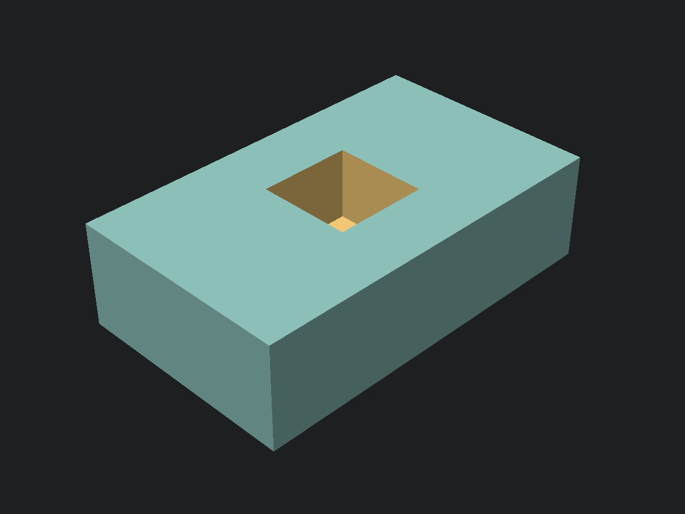

## 6. Первая установка на принтер (настройка ножек)

Принтерами управляет только Main. Перед установкой камеры он паркует голову (`G28`, Y в максимум) и ставит стол в нужный Z.

**K1 SE** (крышку, если есть, снять):
1. Наденьте башмаки K1 на ножки K1 губками к центру. С ножек U1 башмаки снимите.
2. Положите мост по диагонали, хабом над центром.
3. Подвиньте ножки K1 наружу, чтобы губки легли на обе стенки угла, и вдавите их клинья до упора. Мост должен лежать без качания.
4. По живому кадру с калибровочным листом на столе выставьте наклон клиньями подвесов, чтобы клетки у краёв кадра стали одного размера (разница меньше 0.5 %). Дальше клинья не трогать.

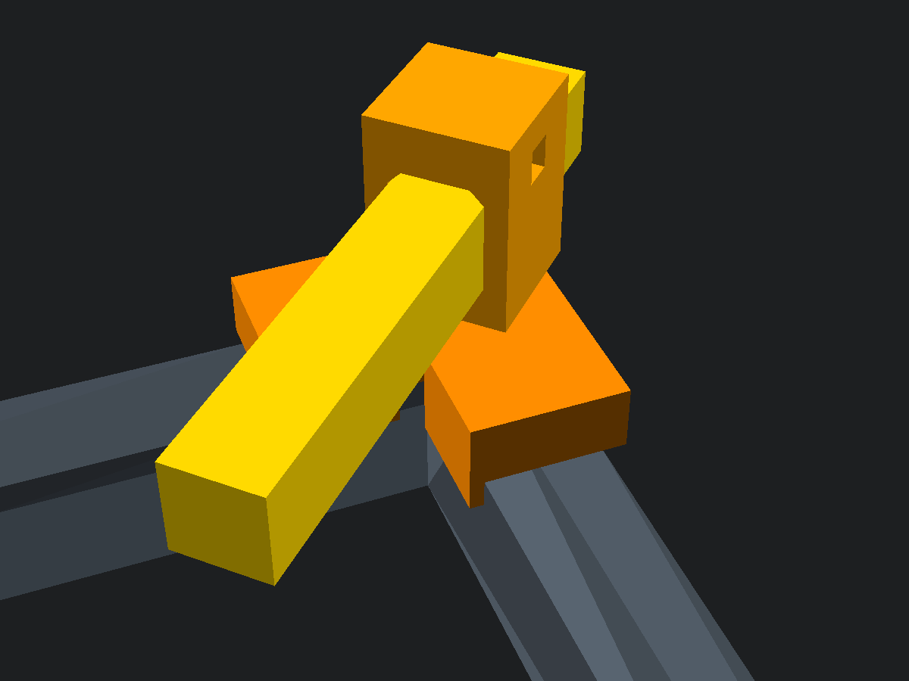

**U1** (снять Top Cover):
1. Башмаки U1 на ножки U1, башмаки K1 снять.
2. Положите мост из заднего левого угла в передний правый.
3. Сдвигайте ножки U1, пока колышки не провалятся в подушки, затем вдавите клинья.
4. Проверьте наклон, как в шаге 4 для K1. Если нужна заметно другая поправка, запишите положения клиньев для каждого принтера: на клиньях есть грань, по ней видно, насколько клин вдвинут.

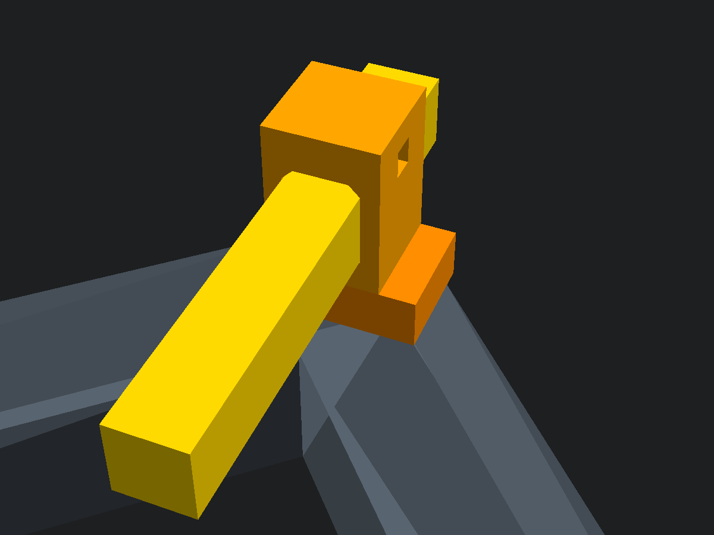
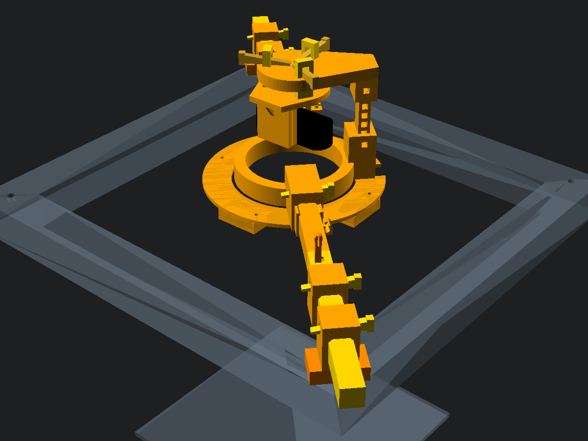

## 7. Каждый раз

1. Main паркует голову и ставит стол в нужный Z.
2. Наденьте башмаки нужного принтера, снимите башмаки другого.
3. Положите мост: на K1 губками в углы, на U1 колышками в подушки. Больше ничего не трогать.
4. Снимок C920 в **2304×1536 YUYV**. Фокус, экспозиция и баланс белого ручные и зафиксированы.

Перед печатью мост снять. Камера держится в пазу собственным весом, поэтому переносите мост горизонтально.

## 8. Файлы

- `camera_mount.scad` — параметрическая модель: `part=` выбирает деталь, стол или вид, `printer=` — `k1se` или `u1`.
- `build.py` — пересобирает все STL (`stl/`, `stl/plates/`, `stl/fit/`) и картинки (`img/`).
- `fits.yaml` — посадки для `3d fit-check --spec`: шип ножки ↔ башмак, стойка ↔ хаб и кронштейн.
- Проверки:
  - `3d check camera_mount.scad -D 'part="hub"'` — каждая деталь PASS;
  - `3d fit-check --spec models/camera_mount/fits.yaml` — PASS;
  - `pytest tests/test_camera_mount_model.py`.
